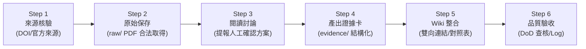
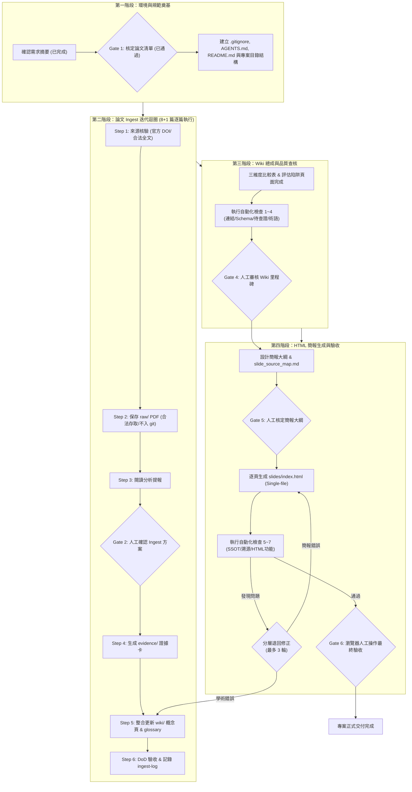

# AGENTS.md：3D 重建與品質評估 LLM Wiki 維護與執行手冊

本文件為維護本知識庫（LLM Wiki）與產生衍生教學教材（HTML 簡報）的 **最高指導行為手冊**。所有在此專案中工作的 AI 代理人（Agents）與協作者，均必須嚴格遵守本文件所載之架構、作業流程、學術引用規範、名詞定義與品質檢核門檻。

---

## 1. 專案核心願景與目標讀者定位

### 1.1 專案核心主題
- **主題名稱**：《從照片到可信任的 3D 模型：3D 重建技術與品質評估入門》
- **核心探討**：多視角 3D 重建原理、神經輻射場（NeRF）、3D Gaussian Splatting（3DGS）、代表性學術資料集、視覺品質與幾何品質的本質差異、為什麼「視覺逼真不代表幾何形狀正確或細節完整」，並延伸探討二手商品 3D 重建的局部缺陷檢驗與模型完整度評估。

### 1.2 目標讀者定位（Persona）
- **主要對象**：跨領域初學者與產品應用評估者（著重理解技術本質、能力邊界、品質好壞判斷標準與二手商品檢驗潛力；不要求具備程式設計、深度學習或 3D 建模背景）。
- **次要對象**：技術入門者（希望理解演算法機制與指標公式意義，但尚未要動手實作演算法）。

### 1.3 知識呈現深度分層（Wiki vs. HTML 簡報）
- **Wiki 概念層（單一事實來源，SSOT）**：
  - 採「觀念為主，輔以少數關鍵核心公式」。
  - 重要評估公式（如 PSNR, Chamfer Distance, F-score）逐一拆解符號與物理幾何意義。
  - 高難度數學推導（如 NeRF 體積渲染積分公式、3DGS 協方差矩陣與高斯投影計算）置於「進階補充區」，不作繁複推導。
- **HTML 簡報層（教學教材）**：
  - 採「直觀理解、流程圖解、生活比喻」為核心，降低認知負擔。
  - 避免大段公式推導，必要時僅呈現簡化直觀公式，著重決策邏輯、指標意義與品質評判。

---

## 2. 專案架構與檔案管理策略

專案採 **`raw/`（原始論文）$\to$ `evidence/`（結構化證據卡）$\to$ `wiki/`（概念知識頁面）$\to$ `slides/`（教學簡報）** 單向流動架構：

```
3D_Reconstruction_Wiki/
├── .gitignore                      # 排除原始版權 PDF 與大型資料集檔案
├── AGENTS.md                       # 本規範手冊（代理人行為指引）
├── README.md                       # 專案導覽、知識架構地圖與使用說明
├── raw/                            # 本地端保存原始文獻（不入 Git）
├── evidence/                       # 每篇論文的結構化證據卡（公開）
├── wiki/                           # 概念知識百科頁面、比較表與詞典（公開）
└── slides/                         # HTML 教學簡報與來源映射表（公開 / GitHub Pages）
```

### 2.1 本地端與公開發布端界線（`.gitignore` 規範）
- **本地端保留（不公開上傳）**：`raw/` 中合法取得的原始論文 PDF、大型暫存資料集，一律由 `.gitignore` 排除，嚴格尊重學術著作權，並保持程式庫輕量。
- **合法取得邊界**：若原始 PDF 因授權限制無法合法取得或保存於本機，應如實標記為 `Pending` 或 `Blocked`。**嚴禁為了滿足完成準則（DoD）而使用不明來源檔案或繞過存取限制**。
- **公開發布端（GitHub / GitHub Pages）**：包含自行整理的 `wiki/`、`evidence/`、`slides/index.html`、官方文獻 DOI / URL、查核紀錄與維護規範。

---

## 3. 權威文獻收錄清單（8 篇核心 + 1 篇補充文獻）

> **【文獻查核狀態聲明】**
> P1–P9 的主要書目資訊及官方來源已完成初步核對；**全文閱讀、研究內容、重要數據、公式、頁碼及圖表證據，將於正式 Ingest 階段逐篇查核**。

### 3.1 核心文獻（8 篇）

1. **P1：NeRF 開創性論文**
   - **正式標題**：*NeRF: Representing Scenes as Neural Radiance Fields for View Synthesis*
   - **第一作者**：Ben Mildenhall
   - **簡稱引用**：Mildenhall et al. (2020)
   - **正式作者完整名單**：Ben Mildenhall, Pratul P. Srinivasan, Matthew Tancik, Jonathan T. Barron, Ravi Ramamoorthi, Ren Ng
   - **出版來源**：ECCV 2020, Part I, LNCS 12346, pp. 405–421
   - **官方來源 / DOI**：[DOI: 10.1007/978-3-030-58452-8_24](https://doi.org/10.1007/978-3-030-58452-8_24)
   - **對應頁面**：`wiki/nerf.md`, `wiki/visual-quality.md`
   - **核心定位**：提出以連續 5D 輻射場隱式表示場景，使用射線步進與體積渲染合成新視角。

2. **P2：3D Gaussian Splatting 開創性論文**
   - **正式標題**：*3D Gaussian Splatting for Real-Time Radiance Field Rendering*
   - **第一作者**：Bernhard Kerbl
   - **簡稱引用**：Kerbl et al. (2023)
   - **正式作者完整名單**：Bernhard Kerbl, Georgios Kopanas, Thomas Leimkühler, George Drettakis
   - **出版來源**：ACM Transactions on Graphics (SIGGRAPH 2023), Vol. 42, No. 4, Article 139, pp. 1–14
   - **官方來源 / Article DOI**：[Article DOI: 10.1145/3592433](https://doi.org/10.1145/3592433) *(注意：專屬 Article DOI 為 10.1145/3592433，勿與期號 DOI 10.1145/3609020 混淆)*
   - **對應頁面**：`wiki/3dgs.md`, `wiki/visual-quality.md`
   - **核心定位**：提出顯式 3D 高斯表示、自適應密度控制與快速可見性感知渲染，實現即時新視角合成。客觀說明特性，不誇大宣稱已完全解決所有速度問題。

3. **P3：真實商品 3D 資料集論文（ABO）**
   - **正式標題**：*ABO: Dataset and Benchmarks for Real-World 3D Object Understanding*
   - **第一作者**：Jasmine Collins
   - **簡稱引用**：Collins et al. (2022)
   - **正式作者完整名單**：Jasmine Collins, Shubham Goel, Kenan Deng, Achleshwar Luthra, Leon Xu, Erhan Gundogdu, Xi Zhang, Tomas F. Yago Vicente, Thomas Dideriksen, Himanshu Arora, Matthieu Guillaumin, Jitendra Malik
   - **出版來源**：IEEE/CVF CVPR 2022, pp. 21126–21136
   - **官方來源 / DOI**：[DOI: 10.1109/CVPR52688.2022.02045](https://doi.org/10.1109/CVPR52688.2022.02045)
   - **對應頁面**：`wiki/datasets.md`, `wiki/secondhand-application.md`
   - **核心定位**：真實商品多視角資料集（含 147,702 商品清單、398,212 目錄照片、8,222 具 360 度影像、7,953 個藝術家設計 3D Mesh，非真實物理掃描 GT；相機參數來自渲染 benchmark）。作為商品級 3D 資料案例，非二手刮痕資料集。

4. **P4：物件中心多視角影片資料集論文（uCO3D）**
   - **正式標題**：*UnCommon Objects in 3D*
   - **第一作者**：Xingchen Liu
   - **簡稱引用**：Liu et al. (2025)
   - **正式作者完整名單**：Xingchen Liu, Piyush Tayal, Jianyuan Wang, Jesus Zarzar, Tom Monnier, Konstantinos Tertikas, Jiali Duan, Antoine Toisoul, Jason Y. Zhang, Natalia Neverova, Andrea Vedaldi, Roman Shapovalov, David Novotny
   - **出版來源**：IEEE/CVF CVPR 2025, pp. 14102–14113 (Preprint: arXiv:2312.13313, 2023)
   - **官方來源 / DOI**：[DOI: 10.1109/CVPR52734.2025.01316](https://doi.org/10.1109/CVPR52734.2025.01316)
   - **對應頁面**：`wiki/datasets.md`, `wiki/completeness-and-defect-retention.md`
   - **核心定位**：涵蓋超過 1,000 種物件類別的 360 度影片資料集，標註含相機姿態、深度圖、稀疏點雲及 3DGS 重建（稀疏點雲非獨立量測之 Ground Truth）。

5. **P5：3D 表面重建權威綜述**
   - **正式標題**：*Deep-Learning-Based 3-D Surface Reconstruction—A Survey*
   - **第一作者**：Anis Farshian
   - **簡稱引用**：Farshian et al. (2023)
   - **正式作者完整名單**：Anis Farshian, Markus Götz, Gabriele Cavallaro, Charlotte Debus, Matthias Nießner, Jón Atli Benediktsson, Achim Streit
   - **出版來源**：Proceedings of the IEEE, Vol. 111, Issue 11, pp. 1464–1501, 2023
   - **官方來源 / DOI**：[DOI: 10.1109/JPROC.2023.3321433](https://doi.org/10.1109/JPROC.2023.3321433)
   - **對應頁面**：`wiki/foundations.md`, `wiki/geometric-quality.md`, `wiki/evaluation-comparison.md`
   - **核心定位**：全面梳理點雲、網格、體素與隱式曲面等表示法，以及幾何評估協定、表面品質與重建完整度概念。

6. **P6：結構相似性指標（SSIM）奠基論文**
   - **正式標題**：*Image Quality Assessment: From Error Visibility to Structural Similarity*
   - **第一作者**：Zhou Wang
   - **簡稱引用**：Wang et al. (2004)
   - **正式作者完整名單**：Zhou Wang, Alan C. Bovik, Hamid R. Sheikh, Eero P. Simoncelli
   - **出版來源**：IEEE Transactions on Image Processing (TIP), Vol. 13, Issue 4, pp. 600–612, 2004
   - **官方來源 / DOI**：[DOI: 10.1109/TIP.2003.819861](https://doi.org/10.1109/TIP.2003.819861)
   - **對應頁面**：`wiki/visual-quality.md`
   - **核心定位**：提出以結構資訊為基礎的影像品質評估方法，作為傳統像素誤差評估方式的互補框架，不應解讀為完全取代 MSE 或 PSNR。

7. **P7：深度特徵感知距離指標（LPIPS）奠基論文**
   - **正式標題**：*The Unreasonable Effectiveness of Deep Features as a Perceptual Metric*
   - **第一作者**：Richard Zhang
   - **簡稱引用**：Zhang et al. (2018)
   - **正式作者完整名單**：Richard Zhang, Phillip Isola, Alexei A. Efros, Eli Shechtman, Oliver Wang
   - **出版來源**：IEEE/CVF CVPR 2018, pp. 586–595
   - **官方來源 / DOI**：[DOI: 10.1109/CVPR.2018.00068](https://doi.org/10.1109/CVPR.2018.00068)
   - **對應頁面**：`wiki/visual-quality.md`
   - **核心定位**：透過人類感知相似度判斷資料集，研究深度神經網路特徵作為感知距離指標的有效性；其結果顯示深度特徵在該研究實驗設定下具有良好的人類感知相似度評估能力（避免過度延伸為所有場景的唯一或萬能標準）。

8. **P8：場景級 3D 重建幾何評估基準論文（Tanks and Temples）**
   - **正式標題**：*Tanks and Temples: Benchmarking Large-Scale Scene Reconstruction*
   - **第一作者**：Arno Knapitsch
   - **簡稱引用**：Knapitsch et al. (2017)
   - **正式作者完整名單**：Arno Knapitsch, Jaesik Park, Qian-Yi Zhou, Vladlen Koltun
   - **出版來源**：ACM Transactions on Graphics (SIGGRAPH 2017), Vol. 36, Issue 4, Article 78, pp. 1–13
   - **官方來源 / Article DOI**：[Article DOI: 10.1145/3072959.3073599](https://doi.org/10.1145/3072959.3073599)
   - **對應頁面**：`wiki/geometric-quality.md`, `wiki/evaluation-pitfalls.md`
   - **核心定位**：使用工業級光達（LiDAR）掃描獲取真實場景 Ground Truth，並定義基於指定距離閾值 $\tau$ 的 Precision、Recall 與 F-score 評估協定（非二手商品瑕疵資料集）。

### 3.2 補充文獻（第 9 篇）

9. **P9：點集生成網絡與幾何距離公式補充文獻**
   - **正式標題**：*A Point Set Generation Network for 3D Object Reconstruction From a Single Image*
   - **第一作者**：Haoqiang Fan
   - **簡稱引用**：Fan et al. (2017)
   - **正式作者完整名單**：Haoqiang Fan, Hao Su, Leonidas J. Guibas
   - **出版來源**：IEEE CVPR 2017 *(頁碼備註：CVF Open Access 標記 pp. 605–613；Proceedings 書目標記 pp. 2463–2471；最終印刷與 PDF 頁碼於正式 Ingest 實際版本時核實記錄)*
   - **官方來源 / DOI**：[CVF Open Access](https://openaccess.thecvf.com/content_cvpr_2017/html/Fan_A_Point_Set_CVPR_2017_paper.html) / [DOI: 10.1109/CVPR.2017.264](https://doi.org/10.1109/CVPR.2017.264)
   - **對應頁面**：`wiki/geometric-quality.md`
   - **核心定位**：作為 Chamfer Distance（CD）與 Earth Mover's Distance（EMD）在深度學習點集重建任務中公式定義、計算特性與適用情境的學術引用依據（明確聲明不將 CD 數學概念起源歸因於本論文）。

---

## 4. 品質評估三維度與防誤導機制

### 4.1 三個獨立品質維度定義與名詞消歧義
AI 代理人必須嚴格區分以下定義，嚴禁混為一談：

1. **視覺品質（Visual Quality）**：
   - 核心問題：新視角渲染影像是否在像素或人眼感知層面逼真？
   - 核心指標：PSNR, SSIM, LPIPS。
   - 邊界：**渲染逼真絕對不等於 3D 空間形狀正確**。
2. **幾何品質（Geometric Quality）**：
   - 核心問題：重建的 3D 空間幾何表面與真值（Ground Truth）距離多近？
   - 核心指標：Chamfer Distance, Accuracy, Precision, Recall, F-score（必須註明距離閾值 $\tau$），以及：
     - **幾何完整度（Geometric Completeness）**：在給定幾何評估協定與距離閾值 $\tau$ 下，測量重建表面覆蓋參考表面（Ground Truth）的比例。
3. **模型完整度與局部缺陷保留（Completeness & Local Defect Retention）**：
   - 核心問題：模型是否具備巨觀結構完整性，以及細微瑕疵是否被保留？
     - **結構覆蓋度（Structural Coverage）**：物體巨觀結構（正面、背面、底部及重要盲區）是否完整重建、有無大面積破洞或缺面。
     - **局部缺陷保留（Local Defect Retention）**：原始物體表面的微小刮痕、裂痕、凹陷是否在重建後保留，而非被演算法過度平滑化消除。
   - 邊界：**必須清楚標明哪些是學術標準指標，哪些是本專案針對二手檢驗延伸提出的評估構想**。

### 4.2 評估指標 6 大診斷問題規範
在撰寫任何指標內容時，必須明確回答：
1. 這個指標到底在測量什麼？
2. 它需要什麼樣的參考資料（Ground Truth）？
3. 分數高或低代表什麼物理意義？
4. 它能發現什麼問題？
5. 它無法單獨發現什麼問題（盲點）？
6. 什麼情況下不能拿它與其他論文的分數直接比較？

### 4.3 跨論文比較之可信度標籤規範
跨論文比較表格強制附帶完整實驗條件（資料集、解析度、姿態已知/估計、深度先驗、GT 形式、輸出格式、閾值），並標註以下標籤：
- `[Comparable]`：可直接比較（實驗協定與資料集一致）。
- `[Partially Comparable]`：有限度比較（標明差異）。
- `[Non-comparable]`：不可直接比較（條件或協定存在根本差異）。
- `[Unknown]`：**目前尚無法確認該條件（嚴禁臆測，阻擋進入簡報作為已確認事實）**。
- `[Not Reported]`：**已確認原始論文未交代該條件（允許在簡報中如實呈現為原論文限制）**。

---

## 5. 引用粒度、語言與術語標準

### 5.1 引用粒度（Section-Level + 頁碼與圖表）
- 採用**等級 A（論文章節級）**為基礎：
  - 演算法流程、技術限制、實驗數據、公式定義必須標註論文、章節或證據卡連結。
  - 重要數據、規格與結論必須精確對應至頁碼（區分 PDF 頁碼與印刷頁碼）、表格編號或圖表編號。
  - 一般常識（RGB 像素、基礎針孔相機概念、生活比喻）免引用。
  - **嚴禁將 AI 推論偽裝為作者結論**；自行設計之示意圖必須標註為「概念示意圖」。

### 5.2 語言與專有名詞規範
- 全站統一採用**繁體中文（台灣用語）**，嚴禁簡體字與非台灣慣用語（如將「資訊」寫為「信息」、「最佳化」寫為「優化」需嚴格審視語境）。
- **首次出現規則**：「繁體中文名稱（英文原名，英文縮寫）」，如：神經輻射場（Neural Radiance Fields, NeRF）、倒角距離（Chamfer Distance, CD）。
- **保留英文不強行翻譯**：NeRF、3DGS、PSNR、SSIM、LPIPS、Ground Truth、Mesh、COLMAP、SfM、Splatting（3D Gaussian Splatting 維持英文原名與 3DGS 縮寫，不硬翻）。
- **核心概念嚴格釐清**：SfM 為技術概念，COLMAP 為軟體工具，兩者不可混為一談。
- 專門建立 `wiki/glossary.md` 提供中英對照與易混淆概念解析。

---

## 6. 單篇論文 Ingest 六階段作業流程與完成準則（DoD）

AI 代理人處理每篇論文時，必須單篇獨立循環執行以下 6 個階段：



### 6.1 六階段作業指引
- **Step 1：文獻來源與元資料核驗（Source Verification）**：透過 CVF, ACM, IEEE 等官方管道核對正式標題、作者、年份、DOI、出版狀態（Preprint 標明）。
- **Step 2：原始資料保存（raw/）**：合法保存論文全文 PDF 於本地 `raw/`，記錄取得日期與版本（若授權受限則標記 Pending/Blocked，嚴禁使用不明來源）。
- **Step 3：閱讀分析與討論（Discussion Before Generation）**：AI 整理研究背景、貢獻、技術細節、限制與預計更新的 Wiki 頁面，**與人類使用者討論並取得同意後才可生成檔案**。
- **Step 4：產生論文證據卡（Evidence Card Generation）**：於 `evidence/` 建立標準化卡片，完整記載數據、章節、印刷/PDF 頁碼、圖表編號與核心短摘。
- **Step 5：整合更新概念知識頁（Wiki Integration）**：將新知識合成至 `wiki/` 對應概念頁，更新對照表、`glossary.md`，建立雙向 Markdown 超連結。
- **Step 6：Ingest 完成檢查（Quality Assurance）**：核對 DoD，通過後將狀態更新至 `wiki/ingest-log.md`。

### 6.2 完成準則（Definition of Done, DoD）
每篇論文必須完全滿足以下條件，方可標記為 `Completed`：
1. **Metadata Verification**：標題、作者、年份、出版來源均由官方資料核實。
2. **Source Availability**：原始全文已合法取得並確認可讀性。
3. **Content Understanding**：核心貢獻、演算法流程、實驗數據與限制已完整萃取。
4. **Evidence Traceability**：所有主張與數據均標有可查核的章節、頁碼或圖表。
5. **Wiki Integration**：已整合至至少一個 Wiki 概念頁，並具備雙向超連結。
6. **Quality Verification**：無未經驗證之臆測、術語符合規範。
7. **Ingest Log**：於 `wiki/ingest-log.md` 完整登記處理歷程。

---

## 7. HTML 互動教學簡報規格與閉環約束

### 7.1 技術規格
- 檔案位置：`slides/index.html`。
- 技術棧：原生 HTML5、CSS3、Vanilla JavaScript。
- 特性：**單一檔案（Single-file HTML）**，CSS/JS 內嵌，零外部相依性，支援離線雙擊開啟與 GitHub Pages 部署，具備完整 RWD 響應式排版。
- 導覽機制：鍵盤左右箭頭、上一頁/下一頁按鈕、頁碼指示器、進度條、章節目錄（TOC）。

### 7.2 簡報大綱（10–12 頁教學流）
1. 封面：從照片到可信任的 3D 模型
2. 3D 重建是什麼？
3. 為什麼需要多角度照片？（視差與三角測量）
4. NeRF 的基本概念（連續空間與射線步進）
5. 3D Gaussian Splatting 的基本概念（顯式高斯與即時光柵化）
6. NeRF vs. 3DGS 核心特性互動切換比對
7. 3D 重建常用資料集（真實物件 vs. 電商商品，客觀標註性質）
8. 如何判斷影像的視覺品質？（PSNR / SSIM / LPIPS）
9. 如何判斷 3D 幾何品質？（Chamfer Distance / F-score / 閾值）
10. 視覺 vs. 幾何互動比對（視覺逼真 $\neq$ 幾何正確）
11. 模型完整度與局部瑕疵保留（二手商品刮痕消失案例互動）
12. 重點總結、互動隨堂測驗（2–3 題）與來源導引

### 7.3 單一知識來源閉環（Wiki First）
- 建立 `slides/slide_source_map.md`，每頁投影片必須映射到具體的 Wiki 概念頁面與已驗證的 Evidence Card。
- 每頁包含可展開之「知識來源標籤抽屜」，展示作者、年份、章節與頁碼。
- **嚴禁簡報超綱偷渡外部知識**：若簡報需補充新案例或比喻，必須先回寫更新 `wiki/` 並經查核後，方可反映於簡報。

---

## 8. 品質保證（QA）、人工確認關卡與執行迴圈

### 8.1 自動化檢查體系（7 大面向）
1. **Link Integrity**：檢查 Markdown 本地連結、錨點、檔案路徑與雙向連結有效性。
2. **Evidence Schema**：檢查證據卡必填欄位完整性。
3. **Unresolved Tracker**：
   - 掃描 `Needs Verification`、`Pending`、`Blocked` 及未經查核的 `Unknown`，產出待辦清單，**嚴禁進入簡報作為已確認事實**。
   - 掃描 `Not Reported`：確認為原論文未提供者，**允許在簡報中如實呈現為原論文限制**。
4. **Terminology Linting**：比對 `glossary.md`，檢查首次中英對照、術語一致性與禁用簡體字。
5. **SSOT Coverage**：依據 `slide_source_map.md` 檢查簡報內容是否 100% 來自已確認的 Wiki 頁面。
6. **Claim Traceability**：檢查簡報數據、年份、公式是否具備明確章節/頁碼/圖表來源。
7. **HTML QA**：檢查頁數、按鈕、鍵盤事件、進度條、抽屜展開、測驗邏輯與 RWD 排版溢出。

### 8.2 人工確認關鍵節點（Human-in-the-Loop 6 大門檻）
- **Gate 1**：8 篇核心及 1 篇補充論文收錄決策（已由使用者確認通過）。
- **Gate 2**：單篇論文 Ingest 前之閱讀分析方案確認。
- **Gate 3**：跨論文數據衝突與學術爭議裁決。
- **Gate 4**：Wiki 概念頁面與比較表階段性驗收。
- **Gate 5**：HTML 簡報大綱與 `slide_source_map.md` 確認。
- **Gate 6**：HTML 簡報瀏覽器操作體驗與最終驗收。

### 8.3 分層退回路由（Targeted Rollback）與停止條件
- 文獻錯誤 $\to$ 退回 Source Verification
- 數據/頁碼錯誤 $\to$ 退回 Evidence Card
- 概念缺漏/錯誤 $\to$ 退回 Wiki 頁面
- 簡報超綱 $\to$ 退回 Slide Draft
- 簡報邏輯不順 $\to$ 退回 Slide Outline
- HTML/CSS/JS 故障 $\to$ 退回前端程式碼修正（不重作 Wiki）
- *停止條件*：最多進行 3 輪自動修復；若仍未通過則輸出診斷清單由人類裁決。

---

## 9. 系統執行 Loop / Graph 全貌


