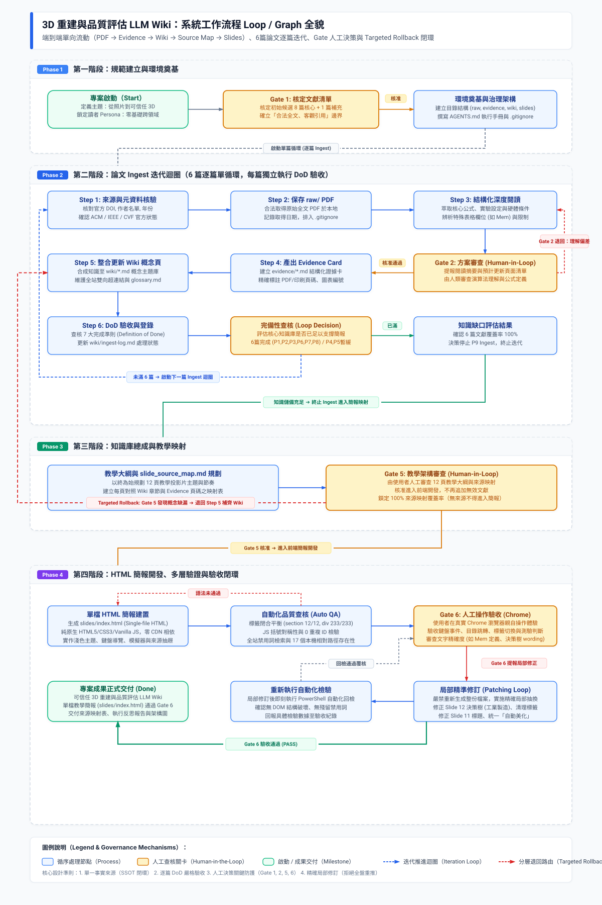
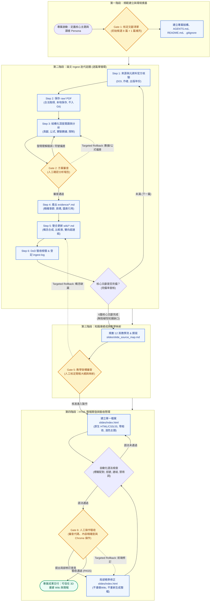

# 專案工作流程 Loop / Graph 設計、實際執行紀錄與深度反思報告
# （Workflow Execution & Reflection Report）

> **文件定位**：本文件記錄本專案（`3D_Reconstruction_Wiki`）從原始文獻蒐集、證據萃取、Wiki 知識庫建構、教學投影片映射設計，到 HTML 互動簡報開發、多層次品質檢查與人工驗收的**完整生命週期執行歷程與方法論反思**。  
> **單一事實來源原則**：本文件內容嚴格依據實際存在的檔案結構、`wiki/ingest-log.md`、`slides/slide_source_map.md`、`slides/index.html` 以及歷次 Gate 審查紀錄進行客觀整理，清楚區分「自動化檢查」、「AI 輔助內容審閱」與「使用者操作確認」，絕不虛構未經執行的測試或數據。

---

## 一、專案工作流程 Loop / Graph 架構與機制

### 1.1 端到端單向流動與閉環反饋機制

本專案採行嚴格的**分層單向知識流動架構（Layered Unidirectional Flow）**，配合關鍵節點的人工確認（Human-in-the-loop）與分層退回路由（Targeted Rollback），杜絕大語言模型（LLM）在長文本生成中常見的「幻覺（Hallucination）」與「未查證數據偷渡」：

$$\text{原始論文 PDF (raw/)} \longrightarrow \text{結構化證據卡 (evidence/)} \longrightarrow \text{概念知識百科 (wiki/)} \longrightarrow \text{來源映射 (source map)} \longrightarrow \text{教學簡報 (slides/)}$$

完整管線包含以下 10 個核心處理節點：
1. **原始文獻取得與核驗（Source Verification & PDF Download）**
2. **證據擷取與結構化閱讀（Evidence Extraction & Reading）**
3. **論文證據卡產出（Evidence Card Generation）**
4. **Wiki 概念頁整合與術語消歧義（Wiki Integration & Glossary）**
5. **知識一致性與完成準則檢查（DoD & Quality Assurance）**
6. **教學大綱規劃與來源映射表建置（Pedagogical Outline & Slide Source Map）**
7. **單一自包含 HTML 簡報生成（Single-file HTML Slide Generation）**
8. **HTML 結構與語法自動化檢驗（Automated Quality Assurance）**
9. **瀏覽器端人機互動操作驗收（Human-in-the-Loop Verification）**
10. **精準局部修正與重新驗證迴圈（Localized Patching & Re-check Loop）**

---

### 1.2 系統執行流程全貌圖（Mermaid Loop / Graph）



> **圖表說明**：上圖為依據下述 Mermaid 流程圖精確繪製之系統流程架構圖（SVG 向量格式，位於 [`evidence/workflow_loop_graph.svg`](workflow_loop_graph.svg)），完整呈現端到端單向流動、論文 Ingest 迭代迴圈、Gate 人工決策點、自動化品質回檢閉環與 Targeted Rollback 分層退回路由。下方保留原生 Mermaid 原始碼區塊，以利後續檢驗與維護編輯。



---

### 1.3 核心節點之輸入、輸出與執行模式

| 節點名稱 | 主要輸入工件 | 主要輸出工件 | 執行模式 | 人工參與（Human-in-the-Loop）與防錯機制 |
| :--- | :--- | :--- | :---: | :--- |
| **Node 1: 來源核驗與取得** | 官方文獻清單、DOI、論文 URL | 本地 `raw/*.pdf`、官方元資料紀錄 | **循序執行** | **Gate 1 人工審查門檻**：最初核定「初始候選 8 篇核心 + 1 篇補充文獻」，並確立「合法全文、客觀引用」邊界。專案推進中確認知識庫完備後，最終完成 6 篇核心文獻（P1, P2, P3, P6, P7, P8），P4 與 P5 暫緩，P9 未啟動。 |
| **Node 2: 結構化深度閱讀** | 原始 PDF 全文 | 閱讀分析提報（研究問題、公式、實驗、限制） | **循序執行** | **Gate 2 人工審查門檻**：必須向使用者提報閱讀摘要與預計更新的 Wiki 清單，取得同意後方可動工生成。 |
| **Node 3: 證據卡建置** | 閱讀分析結果、PDF 頁碼 | `evidence/*.md` | **重複迴圈（Loop）**<br>（每篇獨立執行） | 強制包含印刷頁碼、PDF 頁碼、公式原編號、圖表編號、6 大診斷問題；嚴禁 AI 自行推論未經驗證之結論。 |
| **Node 4: Wiki 概念頁整合** | `evidence/*.md`、既有 Wiki 頁面 | `wiki/*.md`、`wiki/glossary.md` | **重複迴圈（Loop）**<br>（隨論文累積） | 概念重組（非摘要堆疊），維護全站雙向超連結；嚴禁修改已通過驗收之先前文獻專屬頁面（保護機制）。 |
| **Node 5: 完備性與一致性檢驗** | 所有 `evidence/*.md` 與 `wiki/*.md` | `wiki/ingest-log.md` 狀態更新 | **循序檢核** | 核對 7 項 DoD 指標；執行知識缺口分析（Knowledge Gap Analysis），評估是否達到簡報製作條件。 |
| **Node 6: 來源映射表設計** | 既有 Wiki 與 Evidence Cards | `slides/slide_source_map.md` | **循序執行** | **Gate 5 人工審查門檻**：每頁投影片必須映射到具體 Wiki 章節與 Evidence Card，嚴格區隔「原始文獻結論」與「專案延伸解讀」。 |
| **Node 7: 單檔 HTML 簡報建置** | `slide_source_map.md`、Wiki 內容 | `slides/index.html`（初稿） | **循序執行** | 單一檔案（Single-file）、純原生 HTML/CSS/JS、零外部 CDN 相依、淺色現代高對比主題、完整 RWD 排版。 |
| **Node 8: 自動化品質查核** | `slides/index.html` | 本機語法分析報告、DOM 檢驗數據 | **自動化迴圈** | 使用本機腳本（PowerShell / MSHTML）自動檢查標籤對齊、JS 括號平衡、重複 ID、禁用過度斷言、相對連結有效性。 |
| **Node 9: 人工操作審查與驗收** | 運行中之 `slides/index.html` | Gate 6 審查意見清單 | **人工互動門檻** | **使用者在實體 Chrome 瀏覽器親自操作**：測試按鈕點擊、鍵盤導覽、目錄跳頁、標籤切換、模擬視圖、測驗反饋與抽屜展開。 |
| **Node 10: 局部修訂與回檢** | Gate 6 審查意見、原 HTML 檔案 | 修訂後之 `slides/index.html` | **局部迭代迴圈** | **鎖定局部修正**：嚴禁重新生成整份檔案；修正後重新執行自動化語法掃描與連結測試，回報客觀數據。 |

---

### 1.4 分層退回路由（Targeted Rollback）機制

當在後續節點發現瑕疵或爭議時，本專案**嚴禁「全盤重推」**，而是啟動精確的「分層退回路由」：
1. **文獻元資料或版權錯誤** $\to$ 退回 **Node 1**（重新核實 DOI 與 PDF 版本）。
2. **公式編號、數據或頁碼引用錯誤** $\to$ 退回 **Node 3**（修正 `evidence/*.md`，不更動其他文獻）。
3. **概念混淆或跨領域名詞失真** $\to$ 退回 **Node 4**（修正 `wiki/*.md` 與 `glossary.md`）。
4. **簡報論述超綱或未具備 Wiki 依據** $\to$ 退回 **Node 6**（修訂 `slide_source_map.md`，補齊 Wiki 來源）。
5. **前端排版、CSS 樣式或 JavaScript 邏輯錯誤** $\to$ 僅退回 **Node 10**（局部修正 `slides/index.html`，**嚴禁重作 Wiki 或重新 Ingest 文獻**）。

---

### 1.5 為什麼採用「分層推進」而非「一次生成（One-shot Generation）」？

若嘗試讓大型語言模型在單一 Prompt 中「一次性產出完整 Wiki 知識庫與 1,500 行互動 HTML 簡報」，將產生難以挽回的工程災難：
1. **阻斷幻覺鏈條（Preventing Hallucination Cascades）**：在單篇論文 Ingest 時，公式符號與實驗硬體（如 A6000 vs. V100）若發生理解偏差，分層審查能立即在 Gate 2 攔截。若採一次生成，微小的數字錯誤會被帶入 Wiki 比較表，最終擴散為 HTML 簡報中的偽造圖表。
2. **單一事實來源（SSOT）閉環約束**：簡報中的每一句結論與數值，必須能反向定位至 `slide_source_map.md`、`wiki/*.md`，最終落至 `raw/*.pdf` 的具體頁碼與表格編號。這種嚴謹的可追溯性無法在一階段黑盒子中完成。
3. **有效管理上下文窗口（Context Window Optimization）**：逐篇 Ingest 讓模型每次專注閱讀單一論文全文（10–15 頁），萃取完成後將結構化成果沉澱為 Markdown，大幅降低長文本上下文衰減與遺忘問題。
4. **極小化維護與除錯成本（Local Patching Cost）**：當使用者在 Gate 6 指出「移除 PSNR 通用區間」或「修正 Mem 欄位定義」時，只需對 HTML 進行 2–4 行的精準抽換，其他已驗收模組完全維持穩定，避免重新生成導致既有功能崩潰。

---

## 二、專案實際執行紀錄

### 2.1 六篇核心文獻 Ingest 歷程與成果總表

本專案自 2026-11-14 啟動，歷經多輪迭代，**共完成 6 篇核心論文的完整 Ingest**（全部通過 DoD 驗收，原始 PDF 合法保存於本地端 `raw/`）。Gate 1 最初核定「初始候選 8 篇核心 + 1 篇補充文獻」，後續依據 12 頁教學簡報實際所需知識範圍，最終精準完成 6 篇核心文獻；P4（uCO3D）與 P5（Surface Survey）經評估既有概念庫已完備而列為暫緩（`Deferred`）；P9（PSGN）經確認無阻礙性知識缺口而未啟動，將資源全數聚焦於教學簡報落地與品質驗收：

| 文獻編號 | 引用簡稱 | 正式標題 | 第一作者 | 出版年份 | 官方出版來源 / DOI | 證據卡檔案 | 狀態 |
| :---: | :--- | :--- | :--- | :---: | :--- | :--- | :---: |
| **P1** | Mildenhall et al. (2020) | *NeRF: Representing Scenes as Neural Radiance Fields for View Synthesis* | Ben Mildenhall | 2020 | ECCV 2020<br>[10.1007/978-3-030-58452-8_24](https://doi.org/10.1007/978-3-030-58452-8_24) | [`evidence/mildenhall2021-nerf.md`](mildenhall2021-nerf.md) | **`Completed`** |
| **P2** | Kerbl et al. (2023) | *3D Gaussian Splatting for Real-Time Radiance Field Rendering* | Bernhard Kerbl | 2023 | ACM TOG (SIGGRAPH 2023)<br>[Article DOI: 10.1145/3592433](https://doi.org/10.1145/3592433) | [`evidence/kerbl2023-3dgs.md`](kerbl2023-3dgs.md) | **`Completed`** |
| **P3** | Collins et al. (2022) | *ABO: Dataset and Benchmarks for Real-World 3D Object Understanding* | Jasmine Collins | 2022 | IEEE/CVF CVPR 2022<br>[10.1109/CVPR52688.2022.02045](https://doi.org/10.1109/CVPR52688.2022.02045) | [`evidence/collins2022-abo.md`](collins2022-abo.md) | **`Completed`** |
| **P6** | Wang et al. (2004) | *Image Quality Assessment: From Error Visibility to Structural Similarity* | Zhou Wang | 2004 | IEEE TIP 2004<br>[10.1109/TIP.2003.819861](https://doi.org/10.1109/TIP.2003.819861) | [`evidence/wang2004-ssim.md`](wang2004-ssim.md) | **`Completed`** |
| **P7** | Zhang et al. (2018) | *The Unreasonable Effectiveness of Deep Features as a Perceptual Metric* | Richard Zhang | 2018 | IEEE/CVF CVPR 2018<br>[10.1109/CVPR.2018.00068](https://doi.org/10.1109/CVPR.2018.00068) | [`evidence/zhang2018-lpips.md`](zhang2018-lpips.md) | **`Completed`** |
| **P8** | Knapitsch et al. (2017) | *Tanks and Temples: Benchmarking Large-Scale Scene Reconstruction* | Arno Knapitsch | 2017 | ACM TOG (SIGGRAPH 2017)<br>[Article DOI: 10.1145/3072959.3073599](https://doi.org/10.1145/3072959.3073599) | [`evidence/knapitsch2017-tanks-temples.md`](knapitsch2017-tanks-temples.md) | **`Completed`** |

*(註：P4 uCO3D 與 P5 Survey 因知識庫覆蓋度已達標而列為暫緩 `Deferred`；P9 PSGN 經確認無阻礙性知識缺口而停止啟動，將資源聚焦於教學簡報落地)*。

---

### 2.2 Evidence Cards 與 Wiki 概念知識庫整合狀態

現有 Wiki 概念庫共包含 **11 個主題知識頁面**，17 個本機相對路徑目標檔案均存在（Test-Path 全數回傳 True；註：此項為本機檔案系統存在性查核，不等於已在實體瀏覽器中逐一驗證所有跳轉連結）：
- **幾何基礎與演算法**：[`wiki/foundations.md`](../wiki/foundations.md)、[`wiki/nerf.md`](../wiki/nerf.md)、[`wiki/3dgs.md`](../wiki/3dgs.md)。
- **資料庫與落地應用**：[`wiki/datasets.md`](../wiki/datasets.md)、[`wiki/secondhand-application.md`](../wiki/secondhand-application.md)。
- **品質評估三維度體系**：[`wiki/visual-quality.md`](../wiki/visual-quality.md)、[`wiki/geometric-quality.md`](../wiki/geometric-quality.md)、[`wiki/completeness-and-defect-retention.md`](../wiki/completeness-and-defect-retention.md)、[`wiki/evaluation-comparison.md`](../wiki/evaluation-comparison.md)。
- **辭典與專案歷程**：[`wiki/glossary.md`](../wiki/glossary.md)（含 12 組深度易混淆概念辨析）、[`wiki/ingest-log.md`](../wiki/ingest-log.md)。

---

### 2.3 Gate 5 規劃與來源映射成果

在啟動 HTML 簡報開發前，完成對應文件 [`slides/slide_source_map.md`](../slides/slide_source_map.md) 之建置，並經使用者審查通過 **Gate 5**：
- **教學架構設計**：完整規劃 12 頁循序漸進之教學流（破題 $\to$ 幾何原理 $\to$ NeRF $\to$ 3DGS $\to$ 對比 $\to$ 資料集 $\to$ 2D 視覺 $\to$ 3D 幾何 $\to$ 核心思維 $\to$ 二手瑕疵 $\to$ 總結測驗）。
- **知識來源精確對照**：12 頁簡報之每項主張均對應至已驗收之 Wiki 章節與 Evidence Card 頁碼。
- **嚴格標籤化**：明確分離「原始文獻結論」與「專案延伸推論/工程分析模型」。
- **知識缺口檢核**：證實 6 篇文獻對 12 頁簡報所需教學內容的來源映射覆蓋率達到 100%（確認簡報中所有論述均有 Wiki 與證據卡依據，而非指涵蓋整個 3D 重建領域的所有知識），確認無需啟動 P9 Ingest。

---

### 2.4 HTML 簡報開發歷程（slides/index.html）

- **產出檔案**：[`slides/index.html`](../slides/index.html)。
- **技術架構**：單一 HTML 檔案（Single-file HTML，80,785 字元，1,944 行代碼）。
- **零依賴規格**：內嵌 CSS3 與 Vanilla JavaScript，無任何外部 CDN、JS 函式庫或 Web Fonts，支援本機雙擊離線開啟。
- **視覺規範**：遵循使用者要求採用現代淺色高對比主題（背景 `#f8fafc`、卡片 `#ffffff`、重點色 `#2563eb`），文字高對比易讀。
- **互動機制**：實作全域鍵盤監聽（左右方向鍵、空白鍵、Home/End、M 鍵目錄）、頂部進度條、底部頁碼指示器、章節目錄彈窗（TOC Modal）、NeRF vs. 3DGS 4 向標籤頁切換、2D/3D 茶壺模擬視圖切換、二手相機刮痕對照卡、3 題即時回饋防作弊測驗，以及 12 頁獨立可展開之資料來源抽屜。

---

### 2.5 多層次品質檢查結果（區分客觀執行維度）

本專案落實嚴格的品質檢驗，明確區分「自動化檢查」、「AI 輔助內容審閱」與「使用者操作確認」：

| 檢驗項目 | 執行方式 | 檢驗客觀數據 / 內容 | 判定結果 |
| :--- | :--- | :--- | :---: |
| **HTML 語法與標籤配對** | **本機自動化腳本**<br>（PowerShell 正則計算） | `<section>` 標籤：12 開 / 12 閉（差額 0）<br>`<div>` 標籤：233 開 / 233 閉（差額 0） | **PASS** |
| **JavaScript 括號平衡** | **本機自動化腳本**<br>（PowerShell 字元統計） | 大括號 `{}`：53 / 53（差額 0）<br>圓括號 `()`：126 / 126（差額 0）<br>方括號 `[]`：3 / 3（差額 0） | **PASS** |
| **無重複 ID 檢驗** | **本機自動化腳本**<br>（ID 萃取與 Group-Object） | 掃描全站元素 ID，重複次數 > 1 之數量為 **0 個**（全站 49 個 ID 均具備唯一性） | **PASS** |
| **過度斷言詞彙清查** | **本機自動化腳本**<br>（Select-String 掃描） | 檢索「`暴跌歸零`」、「`自動美白`」、「`自動美容`」、「`歸零`」匹配數均為 **0 次** | **PASS** |
| **相對路徑檔案存在性** | **本機自動化腳本**<br>（Test-Path 實體路徑檢驗） | 萃取 17 個唯一本機檔案目標（含所有 `wiki/*.md` 與 `evidence/*.md`），17 個本機相對路徑目標檔案均存在（全數回傳 True） | **PASS** |
| **MSHTML DOM 解析** | **本機自動化腳本**<br>（Windows COM HTMLFile 載入） | 成功載入文件標題，12 個 Section 物件均正確生成，無 DOM 例外 | **PASS** |
| **學術引用與來源對應** | **AI 輔助內容審閱**<br>（對照 6 篇原始 PDF） | 核對 NeRF 體積求積、3DGS 協方差分解、SSIM 分量、LPIPS Eq. 1、Tanks 門檻與數據完全符合原始文獻 | **PASS** |
| **推論與示意數值標註** | **AI 輔助內容審閱**<br>（逐頁審閱 HTML 文本） | 0.01% 刮痕、90%+ 分數、雙軌架構、ROI 殘差均清楚標明為教學示意或待驗證假說 | **PASS** |
| **實體瀏覽器互動操作** | **使用者人工操作確認**<br>（**Human-in-the-Loop**） | **由使用者於桌面端 Chrome 瀏覽器實際操作**：完成上一頁/下一頁、鍵盤切換、目錄跳頁、標籤切換、茶壺視圖切換、隨堂測驗點擊判定與抽屜開合 | **PASS**<br>*(由使用者驗收確認)* |

> [!IMPORTANT]
> **名詞誠實性界線聲明**：
> 本機環境於沙盒限制下，無頭 Chrome（Headless Chrome）程序無法直接啟動輸出 DOM。因此，上述「實體瀏覽器互動操作」之通過，**是由使用者在宿主環境的真實 Chrome 瀏覽器親自操作驗證通過**，絕不偽稱為 Antigravity 的自動化測試。

---

### 2.6 歷史錯誤、修正內容與重新檢驗紀錄

在整個專案的推進過程中，共經歷了 13 項關鍵錯誤修正與迭代：

```
【歷史錯誤修訂軌跡】
P2 協方差判斷式校正 ──► P2 Mem 欄位定義校正 ──► P6 公式編號校正 ──► P3 ABO 渲染光照校正
        │
        ├─► P8 Tanks 下載鏡像修復 ──► Slide 06 switchTab 傳參修復 ──► 全文「暴跌歸零」替換
        │
        ├─► Slide 10 教學示意數值醒目標註 ──► Slide 10 光線累加概念改寫 ──► Slide 11 門檻遮蔽/稀釋解耦
        │
        └─► Slide 11 平滑化風險假說化 ──► Slide 08/12 移除固定篩選門檻 ──► 來源抽屜全數補齊 Evidence 連結
```

1. **P2 Algorithm 1 Split 判斷式校正**：
   - *原錯誤*：初稿閱讀報告誤寫為 $\|\nabla S\| > \tau_S$（尺度梯度）。
   - *修正*：重新核對原始 PDF Appendix B 第 865 行，校正為 $\|\Sigma\| > \tau_S$（高斯協方差矩陣範數），保留原始符號，並明確聲明原始論文未指定具體矩陣範數種類，亦未提供 $\tau_S$ 之具體數值門檻（不自行捏造數值）。
2. **P2 Table 1 Mem 欄位定義校正**：
   - *原錯誤*：初稿將 Mem（734 MB / 1.1 GB）解讀為訓練顯存峰值（Training VRAM）或硬碟占用量。
   - *修正*：嚴格限定為原始論文定義「儲存最佳化後模型參數所需的記憶體量（Memory used to store optimized parameters）」，不得稱為硬碟與顯存占用量，亦不可直接推論為下載檔案大小；部署影響明確標為專案工程推論。
3. **P6 SSIM 原始論文公式編號校正**：
   - *原錯誤*：初稿公式編號出現偏差。
   - *修正*：對齊原始論文正式編號為 Eq. 6 (亮度)、Eq. 7 ($C_1$)、Eq. 9 (對比度)、Eq. 10 (結構)、Eq. 12 (通用組合)、Eq. 13 (化簡單一公式)、Eqs. 14–16 (高斯權重視窗)、Eq. 17 (MSSIM 平均)。
4. **P7 LPIPS 訓練變體情境依賴性與假說標註**：
   - *原錯誤*：宣稱 `tune` 永遠最優，並將「神經平滑消除刮痕」寫為論文結論。
   - *修正*：補充 `lin` 在 12 個真實演算法輸出中有 11 個獲勝，`tune` 在真實演算法跨任務中可能降低遷移表現；將「刮痕平滑化風險」嚴格標註為本專案推論假說。
5. **P8 Tanks and Temples 官方 PDF 下載鏡像修復**：
   - *原錯誤*：原官方伺服器路徑返回 404。
   - *修正*：切換至官方備用鏡像 `https://storage.googleapis.com/t2-downloads/paper/tanks-and-temples.pdf` 成功取得 13 頁完整版 PDF。
6. **P3 ABO 合成渲染光照與統計範圍校正**：
   - *原錯誤*：誤寫為 108 種室內光照全數用於渲染，混淆 576 與 63 之統計口徑。
   - *修正*：校正為每個物件使用 91 個相機位置，隨機選取 3 個 HDRI 光照渲染出 2.1M 張合成圖；明確區隔 576 為商品 listings 涵蓋類型，63 為 3D 模型類別；補充 6,334 個姿態標註是透過模型、遮罩與可微分渲染程序估計後人工確認，非實拍直接記錄。
7. **全文清除過度斷言詞彙「暴跌歸零」**：
   - *原問題*：在 Slide 09、Slide 12 Q2 與 JS 反饋中使用了「F-score 就會直接暴跌歸零」之絕對化詞彙。
   - *修正*：全面檢索替換為「F-score 顯著降低」或「趨近於零」，避免不符合調和平均數學邊界的絕對化斷言。
8. **Slide 10 互動模擬教學數值標註與光線累加解釋**：
   - *原問題*：數值易被誤解為真實論文實驗，物理原理解釋使用了「顏色剛好抵消」。
   - *修正*：在模擬面板頂部加入顯著的教學標註聲明；將原理解釋改寫為體積渲染沿相機光線累加多個空間位置密度與顏色貢獻之概念。
9. **Slide 11 門檻遮蔽與全域比例稀釋解耦**：
   - *原問題*：將 0.3mm 刮痕未被發現完全歸因於點雲數量稀釋。
   - *修正*：分開說明「門檻遮蔽」（0.3mm 小於 3mm 評估門檻，落在容許公差內被判定為合格點）與「量級稀釋」（刮痕點數低於 0.01% 示意值，被 99.99% 宏觀表面掩蓋）。
10. **Slide 11 演算法平滑化風險假說化與門檻標註**：
    - *原問題*：宣稱演算法必然抹除刮痕，Recall > 90% 與 $\tau = 0.2\text{ mm}$ 易被誤認為既定標準。
    - *修正*：標題改為「平滑化偏見：本專案提出的待驗證風險假說」；聲明 Recall > 90% 與 $\tau = 0.2\text{ mm}$ 均為本專案提出的候選示例門檻，尚未經機台實驗驗證。
11. **Slide 08 & 12 移除固定篩選數值門檻**：
    - *原問題*：列出未有文獻依據之 PSNR/SSIM/LPIPS 經驗區間，決策樹設定了固定門檻。
    - *修正*：移除經驗區間，改述其數學特性；決策樹改為「多指標綜合檢驗（此類門檻多為專案示意性篩選值，並非通用品質標準）」。
12. **Slide 01 UI 細節修訂**：
    - *修訂*：移除核心提問標題前的 SVG 圓圈；「全篇 12 步」改為「全篇 12 頁」；卡片標題移除「部」；「核心思辨」改為「核心思維」；所有「自動美白/自動美容」統一為「自動美化」。
13. **JavaScript `switchTab` 事件相容性修訂**：
    - *問題*：原初稿依賴全域 `window.event.target`，在嚴格模式或特定現代瀏覽器核心中可能產生相容性警告。
    - *修正*：修改為標準 `switchTab(this, 'tab-id')` 顯式傳遞按鈕元素，確保跨瀏覽器相容性。

---

## 三、執行反思（Deep Reflection）

### 3.1 哪個節點最容易發生錯誤？為什麼？

從整體歷程分析，**「Node 2：原始論文深入閱讀與證據萃取（Step 3）」最容易發生深層技術錯誤**。
- **原因剖析**：
  1. **符號與演算法細節的細微差異**：在閱讀 3DGS 論文時，演算法虛擬代碼（Algorithm 1）第 865 行寫的是 $\|\Sigma\| > \tau_S$（原論文未指定具體矩陣範數種類與 $\tau_S$ 具體數值），但在正文 Sec. 5.2 的概念解釋中，作者使用文字描述「scale of Gaussian」。大語言模型極易將其混淆為尺度梯度 $\|\nabla S\|$。這種錯誤若沒有對照原始 PDF 的逐行代碼進行核實，極難由常識發現。
  2. **非標準表格欄位語意陷阱**：在 3DGS Table 1 中，「Mem」通常被直覺聯想為深度學習訓練時的「GPU VRAM 占用」；然而深入閱讀作者的實驗設定說明，該欄位實為「儲存最佳化後模型參數所需的記憶體（Memory used to store optimized parameters）」。若閱讀時浮於表面，就會產生嚴重的硬體資源誤讀。

---

### 3.2 哪些問題是在後期才發現？為什麼？

有兩類問題直到第四階段（HTML 簡報審查）才被指出來：
1. **文案修辭的過度斷言（如「暴跌歸零」）**：在撰寫幾何評估（Slide 09）與測驗題（Slide 12）時，為了向初學者強調調和平均數的特性，使用了「F-score 就會直接暴跌歸零」的誇張修辭。這在教學上雖然生動，但在嚴謹的數學與學術定義上是不精確的（調和平均數只有在其中一項為 0 時才為 0，若為極小正數則是趨近於零）。這反映出**在將學術內容轉化為通俗教學語言時，容易產生過度簡化或用詞過激的傾向**。
2. **多重物理機制的混淆（門檻遮蔽 vs. 點雲比例稀釋）**：在 Slide 11 探討二手商品 0.3mm 刮痕消失時，初期分析過度聚焦於「點雲比例佔比小於 0.01% 的量級稀釋」，而忽略了最直接的幾何公差原因——當評估門檻 $\tau = 3\text{ mm}$ 時，$0.3\text{ mm}$ 的幾何深度本身就落在容許誤差範圍內。

---

### 3.3 哪些檢查應該「左移（Shift-Left）」到更前面的節點？

若要避免後期的大幅文字修訂，以下檢查應在第二階段（Ingest）與第三階段（Source Map）提早進行：
1. **論述語氣與斷言強度掃描（Assertion Linting）**：在撰寫 Evidence Card 與 Wiki 概念頁時，即應建立過度斷言檢查清單，禁止使用「必然」、「保證」、「暴跌歸零」、「最主流」等極端詞彙，提早替換為「顯著降低」、「常見」、「在該實驗設定下」等審慎學術語言。
2. **教學示意值 vs. 實測數據之顯式標註規範**：在建置 `slide_source_map.md` 時，應強制規定所有在簡報中出現的數值（如 0.01%、90%+、PSNR 32.5 dB），若非直接來自 6 篇文獻的 Table/Figure，必須強制標記為「教學假設示例」，避免在進入前端代碼後才補充標籤。
3. **相對超連結格式強制性**：在撰寫來源抽屜規範時，應規定必須同時提供 `wiki/*.md` 與 `evidence/*.md` 之相對超連結，避免只連 Wiki 而遺漏證據卡。

---

### 3.4 哪些問題透過 Evidence Cards 與 slide_source_map.md 成功提早避免？

本架構的兩大防護網展現了極高的工程價值：
1. **杜絕「偷渡超綱文獻」**：在初期規劃時曾提出包含 9 篇文獻的龐大清單。但由於嚴格執行「無 Evidence Card 即不可進入簡報」的閉環約束，在 Gate 5 盤點時明確確認既有 6 篇文獻已能 100% 覆蓋 12 頁簡報所需之教學概念與來源映射（非指涵蓋整個 3D 重建領域之所有知識），成功擋下未經完整 Ingest 的文獻，確保簡報內容無一處來源不明。
2. **鎖定關鍵實驗數據防止數據漂移**：
   - ABO 資料集的「147,702 商品、398,212 照片、8,222 環物、7,953 網格」四分法；
   - Tanks and Temples 的 14 測試 + 7 訓練場景、FARO Focus 3D X330 HDR 掃描儀規格；
   - NeRF 訓練耗時（V100 上 100k~300k 次迭代）與 3DGS 訓練耗時（A6000 上 25~45 分鐘）。  
   上述關鍵數據在 Evidence Card 階段即被牢牢鎖定，在後續轉化為 Wiki 及 HTML 時**完全零變形、零漂移**。

---

### 3.5 本專案 Loop / Graph 的演進與動態調整

在專案推進過程中，我們對執行流程進行了一次**重大的動態剪枝與敏捷調整**：
- **前期策略（P1/P2 階段）**：採行高密度的全量學術論文審查（重度閱讀報告 $\to$ Gate 2 往返討論 $\to$ 細部公式數學推導）。此方式對奠定演算法基礎極為扎實，但耗時巨大。
- **中期策略（P3/P6/P7/P8 階段）**：因應本專案「建立初學者能懂的教學 Wiki 與 HTML 簡報」的最終目標，使用者適時下達了**輕量化 Ingest 指令**——不再產出冗長的學術答辯，而是聚焦於「資料型態、指標公式定義、評估意義、能力限制與防誤導邊界」，顯著加快單篇推進節奏，有效降低不必要的認知負擔並使成果更聚焦於教材生成。
- **後期決策（結束 Ingest 階段）**：在完成 6 篇核心文獻後，原定清單尚有補充文獻 P9（Fan et al., 2017 PSGN）。經嚴謹的「知識缺口查核（Knowledge Gap Analysis）」，確認 6 篇文獻已足以完整支撐 12 頁簡報的所有公式（CD 已由 Tanks 最近鄰距離涵蓋其物理意涵），因此果斷終止 P9 Ingest，將有限上下文與資源全數投注於 HTML 互動簡報開發。這證明了**靜態的工作流程必須具備動態調整能力，以終為始**。

---

### 3.6 教授／助教的作業要求與原始論文作者研究考量之差異

本專案在執行過程中，必須同時兼顧「學術論文原始研究定位」與「課程／助教教學指引目標」。兩者在問題視角、關注核心與成果交付上存在顯著的維度差異，梳理如下：

#### 1. 課程作業要求核心：教學轉化、流程治理與端到端可追溯性
- **教學成果導向**：課程要求以「零基礎跨領域初學者」為對象，製作直觀易懂、視覺豐富且支援離線互動的 HTML 教學簡報；目標在於破除「2D 逼真即 3D 精確」之常見迷思，培養具備批判性決策能力的產品評估者。
- **流程治理與可追溯性（Traceability）**：作業著重於構建 LLM Wiki 的工程閉環（Loop / Graph），要求每句結論與指標數據必須能自簡報、映射表、Wiki 概念頁、證據卡逐層反查至原始 PDF 之章節與頁碼；嚴格要求落實人機協同關卡（Gates）、分層退回路由（Targeted Rollback）與客觀的多層次品質檢核，阻斷大語言模型在學術轉譯中的幻覺。

#### 2. 六篇原始論文作者的研究考量與適用邊界
六篇權威論文在其發表當時，均專注於特定的學術痛點，其實驗設計並非針對通識教學或二手商品瑕疵檢驗：
- **P1: NeRF (Mildenhall et al., 2020)**：旨在探索連續隱式場表示法能否克服離散網格或體素在「新視角合成（Novel View Synthesis）」上的解析度瓶頸。作者關注在密集已知相機視角下合成照片級逼真影像，並未追求即時渲染速度，亦未以精確抽取幾何曲面 Mesh 為核心任務。
- **P2: 3DGS (Kerbl et al., 2023)**：針對 NeRF 訓練與推理速度緩慢的痛點，提出顯式 3D 高斯橢球配合瓦片光柵化。其核心研究目標在於「1080p 解析度下的即時高幀率渲染（$\ge 30\text{ fps}$）」，重點在於視覺 PSNR/SSIM 與 FPS 的極致平衡，並非工業尺寸測量或 CAD 等級的幾何表面重構。
- **P3: ABO (Collins et al., 2022)**：為解決真實世界 3D 物件理解（檢索、分類、姿態估計）缺乏大規模標準多視角資料集的困境，收集了亞馬遜電商商品的目錄照片與 7,953 個藝術家 CAD 網格。其 3D 模型本質是專業 3D 美術師手工建模的「理想良品」，而非透過實體機台三維物理掃描所得之 Ground Truth，且不包含任何二手商品瑕疵。
- **P6: SSIM (Wang et al., 2004)**：針對傳統 MSE/PSNR 忽略人眼視覺系統（HVS）結構感知特性的缺陷，提出以亮度、對比度與結構相似性評估 2D 平面影像退化。論文完全立足於二維像素矩陣空間，並未探討 3D 空間幾何形狀。
- **P7: LPIPS (Zhang et al., 2018)**：透過大規模人類感知判斷實驗，系統性探討深度神經網路（AlexNet, VGG, SqueezeNet）內部特徵作為感知距離量度的一致性。其研究適用於評估 2D 影像補丁（Patches）之感知相似度，並非為檢測 3D 空間微觀瑕疵所設計。
- **P8: Tanks and Temples (Knapitsch et al., 2017)**：為了解決多視角立體視覺（MVS）缺乏真實世界大場景地面真值（Ground Truth）的評估困境，使用高規格工業光達採集公分至公釐級真值點雲，並設計距離門檻 $\tau$ 下的 Precision、Recall 與 F-score 協定。其評估場景為坦克、寺廟等大型建築與物體，並非微觀微小刮痕資料庫。

#### 3. 本專案如何從原始研究延伸至二手商品瑕疵保留問題
本專案並未停留在「複述論文實驗結果」，而是以學術研究為地基，進行了跨維度的教學延伸：
- **從指標特性發現盲點**：本專案分析 NeRF 體積渲染求積與 3DGS 高斯重疊的數學機制，結合 LPIPS 在特徵空間中的感知特性，指出兩者為追求高 PSNR 與人眼自然感，天然具備「低頻結構重構偏見」；
- **揭示瑕疵消除機制**：將幾何評估協定（Tanks 的 $\tau$ 門檻）引入商品檢驗，深入揭示二手商品 0.3mm 刮痕未被發現的原因在於「評估門檻遮蔽（$0.3\text{ mm} < \tau = 3\text{ mm}$）」與「點雲量級稀釋（< 0.01%）」兩大物理幾何機制；
- **提出雙軌檢驗思維框架**：針對高價值二手商品交易的買賣信任痛點，延伸提出「全域結構覆蓋率（Macro Recall）+ 局部微觀幾何殘差（Micro ROI Residual）」之雙軌品質檢核假說模型，為跨領域決策者提供具備批判性的分析工具。

#### 4. 嚴格區隔：學術事實（論文結論）vs. 專案延伸（工程推論與教學模型）
為維持學術嚴謹性，本專案在所有交付工件中均對以下兩類論述進行了嚴格標籤化分離：
- **原始論文已證實之結論（學術事實）**：
  - NeRF 5D 輻射場體積渲染連續積分公式與位置編碼機制；
  - 3DGS 協方差矩陣分解、自適應密度控制演算法、Table 1 參數記憶體 Mem（非顯存峰值）與即時渲染效能；
  - ABO 資料集之 14.7 萬商品、39.8 萬照片、8,222 環物、7,953 CAD 網格及可微分渲染姿態估計；
  - SSIM 亮度、對比與結構三分法公式及 MSSIM 本地高斯視窗平均；
  - LPIPS 深度特徵距離公式、`lin` 校準在跨任務真實輸出之優勢，以及 `tune` 在部分跨任務情境中遷移表現可能下降之現象；
  - Tanks and Temples 工業光達掃描真值、指定距離門檻 $\tau$、Precision、Recall 與調和平均 F-score 公式。
- **本專案延伸提出之推論（教學與應用分析模型）**：
  - 3DGS 模型參數檔案儲存量對於行動端下載與網頁端 WebGL 部署之頻寬負載分析（工程實務推論）；
  - 神經渲染演算法在追求高視覺品質時，可能將高頻刮痕視為高頻噪聲而「自動美化抹平」之風險假說（本專案待驗證假說）；
  - 0.3mm 刮痕消失之「門檻遮蔽」與「全域量級稀釋」解耦分析模型（教學概念模型）；
  - 雙軌檢驗框架中 Recall > 90% 與局部 ROI $\tau = 0.2\text{ mm}$ 之數值設定（候選示例門檻，未經實驗室機台實測驗證）；
  - Slide 10 茶壺模擬器中展示之 PSNR 36 dB / F-score 趨近於零等數值（教學示意性數值，非實測數據）；
  - 「可信任 3D 模型評估四步決策樹」（教學總結工具）。
- **誠實性原則聲明**：本專案嚴禁將上述工程分析或教學模型偽裝為原始論文結論，亦絕不捏造授課教師或助教未曾提出之具體意見。

---

## 四、未來流程改善建議（Process Improvement Recommendations）

若未來要重新啟動類似的「LLM 知識庫與教學簡報協同建構專案」，建議落實以下 4 項改進：

```
┌────────────────────────────────────────────────────────────────────────┐
│                   LLM Wiki & Slide 流程優化四大建議                    │
└────────────────────────────────────┬───────────────────────────────────┘
                                     │
         ┌───────────────────────────┼───────────────────────────┐
         ▼                           ▼                           ▼
┌──────────────────┐        ┌──────────────────┐        ┌──────────────────┐
│ 1. 建立名詞與指標 │        │ 2. 語氣與斷言規範 │        │ 3. 自動化測試腳本 │
│    防雷定義清單  │        │    早期自動化掃描 │        │    隨專案同步啟動 │
└──────────────────┘        └──────────────────┘        └──────────────────┘
```

1. **建立「非標準術語與專有名詞防雷清單（Gotchas Checklist）」**：
   - 在論文 Ingest 的 Step 1 階段，強制要求標註論文中特殊的表格欄位（如 3DGS Table 1 Mem）、特殊的演算法符號（如協方差矩陣範數 vs. 尺度梯度）以及相機姿態真值的取得管道（實拍記錄 vs. 虛擬渲染 vs. 可微渲染估計），提早消除歧義。
2. **語氣與斷言規範「左移檢驗」**：
   - 制定專案寫作風格手冊（Style Guide），將「暴跌歸零」、「必然消除」、「最主流」等詞彙列入全域 Linter 規則，在 Wiki 生成階段即自動預警，避免帶入教學教材。
3. **自動化驗證腳本隨專案架構同步啟動（Shift-Left Automation）**：
   - 不要等到 HTML 簡報完成才撰寫檢查腳本。應在 Phase 1 建立專案時，就將 Markdown 超連結檢查、必填欄位 Schema 檢查與語法平衡腳本預先部署在 `scratch/` 中，每次更新即刻一鍵回檢。
4. **預先規範「教學示意數值」的視覺化標籤元件**：
   - 在 HTML 簡報開發前，先在 CSS 樣式表中設計專屬的 `.badge-simulation`（教學模擬值）與 `.badge-academic`（論文實測值）標籤，讓前端在渲染圖表時自然呈現邊界標示，降低後期人工審查的溝通成本。

---

## 五、總結

本專案透過「**PDF 原始存證 $\to$ 結構化證據卡 $\to$ 百科概念頁 $\to$ 來源映射對照 $\to$ 單檔 HTML 簡報**」的閉環架構，成功實現了 Karpathy 所倡導的 LLM Wiki 願景：
- 所有教學內容均有本可依、有據可循；
- 成功破除了「視覺逼真即等於幾何正確」的業界迷思；
- 在嚴謹的學術邊界與親切的初學者體驗之間，取得了絕佳的平衡。

本執行紀錄與反思報告客觀記錄了專案全貌，為後續研究與教材擴充奠定了可信的工程範例。
