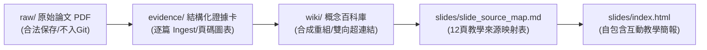

# 需求摘要文件（Requirements Summary）
## 專案主題：《從照片到可信任的 3D 模型：3D 重建技術與品質評估入門》

---

## 一、LLM Wiki 主題與簡介

- **專案全名**：《從照片到可信任的 3D 模型：3D 重建技術與品質評估入門》（From Photographs to Trustworthy 3D Models: An Introduction to 3D Reconstruction and Quality Assessment）
- **主題簡介**：  
  本專案是一套基於大語言模型協同架構（LLM Wiki）所建構的結構化開放知識庫與衍生教學教材。專案核心聚焦於探討：如何從多視角二維照片重建出三維空間模型、神經輻射場（NeRF）與 3D Gaussian Splatting（3DGS）的核心演算法原理、代表性學術資料集（ABO、Tanks and Temples）的客觀標註特性，以及**「視覺品質（2D 渲染影像）」與「幾何品質（3D 空間表面）」的本質差異**。
  
  本專案的核心論證在於破除大眾與產業界常見的認知盲點——**「視覺逼真不等於幾何形狀正確或細節完整」**，並進一步延伸探討在二手高價值商品檢驗與數位典藏中，演算法過度平滑化是否會將微小刮痕「自動美化抹平」的邊界挑戰。

---

## 二、專案研究目的與教學對象

### 2.1 專案研究與產出目的
1. **建立單一事實來源（SSOT）的技術知識庫**：避免傳統 LLM 在技術名詞、數學公式與跨論文實驗數據上的幻覺，以章節與頁碼級的精確度梳理多視角 3D 重建知識。
2. **橋接學術文獻與跨領域實務應用**：將頂級電腦視覺與圖形學學術成果（ECCV, SIGGRAPH, CVPR, IEEE TIP），轉化為清晰易懂、具備決策判斷力的教學內容。
3. **提供可落地的評估思維工具**：提出包含視覺維度、幾何維度與瑕疵保留維度的「可信任 3D 模型評估四步決策樹」，輔助非技術背景決策者正確評判 3D 成果品質。

### 2.2 目標讀者定位（Persona）
- **主要對象（Primary Persona）**：**跨領域初學者與產品應用評估者**（如電商產品經理、二手拍賣平台檢驗員、數位展覽策展人、3D 專案決策者）。
  - *需求特徵*：不具備深厚數學、深度學習或 3D 建模程式背景；需要理解技術本質能力邊界、評判成果好壞（為什麼圖好看但模型不能用），以及評估二手商品瑕疵檢驗之可行性。
- **次要對象（Secondary Persona）**：**技術入門學生與工程師**。
  - *需求特徵*：希望釐清 NeRF、3DGS 與傳統 SfM/MVS 之機制差異，理解 PSNR、SSIM、LPIPS、Chamfer Distance、F-score 之數學公式物理意義與評估盲點，但尚未要動手從頭撰寫底層演算法。

---

## 三、為何選擇此主題（選題動機與背景）

1. **技術爆發與大眾認知脫節**：
   近年 NeRF（2020）與 3DGS（2023）帶動了新視角合成技術的革命，網路上充斥著各種極度逼真、照片級的 3D 旋轉展示影片。然而，大眾乃至許多工程團隊常誤將「渲染視角漂亮」等同於「已成功建立出精準的 3D 實體模型」。
2. **「看得到」不等於「摸得到」的本質鴻溝**：
   新視角合成演算法本質是光線顏色的積分或高斯團的投影累加，其空間中可能存在大量肉眼從特定角度看不出的懸浮漂浮物（Floaters）、背部盲區破洞，甚至是凹凸深度完全顛倒的偽影。若貿然將其投入 3D 列印、工業尺寸量測或物理碰撞模擬，將會徹底失效。
3. **二手商品與高信任交易場景的迫切痛點**：
   在二手高單價商品（如相機鏡頭、手機、精品手錶）線上買賣中，買家最在意的往往是「正面反光處是否有 0.3mm 的刮痕」、「轉角是否有碰撞凹痕」。然而，主流神經重建演算法為追求極致的 PSNR 分數，往往具備低頻重構偏見，傾向於將高頻微小瑕疵視為噪聲並「自動美化平滑」消除。這構成了嚴重的交易信任危機，也是本專案最具實踐意義的研究切入點。

---

## 四、六篇核心文獻及資料來源規劃

本專案於 Gate 1 確立初始候選清單（8 篇核心 + 1 篇補充），後續依據教學簡報所需概念進行動態剪枝，最終**完整且獨立完成了 6 篇權威文獻的深度 Ingest**（全部通過 7 項 DoD 驗收，原始 PDF 合法保存於本地端 `raw/`，不納入 Git 版本庫）：

| 文獻代號 | 正式標題 | 作者與年份 | 出版來源 / DOI | 核心角色與在專案中的定位 |
| :---: | :--- | :--- | :--- | :--- |
| **P1** | *NeRF: Representing Scenes as Neural Radiance Fields for View Synthesis* | Mildenhall et al. (2020) | ECCV 2020<br>[10.1007/978-3-030-58452-8_24](https://doi.org/10.1007/978-3-030-58452-8_24) | **神經隱式表示奠基**：定義連續 5D 輻射場、射線步進與體積渲染積分，奠定新視角合成基礎。 |
| **P2** | *3D Gaussian Splatting for Real-Time Radiance Field Rendering* | Kerbl et al. (2023) | ACM TOG (SIGGRAPH 2023)<br>[Article DOI: 10.1145/3592433](https://doi.org/10.1145/3592433) | **顯式點雲輻射場與即時渲染**：定義 3D 高斯、自適應密度控制與光柵化，分析參數記憶體與渲染效能。 |
| **P3** | *ABO: Dataset and Benchmarks for Real-World 3D Object Understanding* | Collins et al. (2022) | IEEE/CVF CVPR 2022<br>[10.1109/CVPR52688.2022.02045](https://doi.org/10.1109/CVPR52688.2022.02045) | **真實電商商品資料集**：分析 14.7 萬商品、39.8 萬照片與 7,953 CAD 網格，釐清藝術家網格非物理掃描真值。 |
| **P6** | *Image Quality Assessment: From Error Visibility to Structural Similarity* | Wang et al. (2004) | IEEE TIP 2004<br>[10.1109/TIP.2003.819861](https://doi.org/10.1109/TIP.2003.819861) | **2D 視覺結構品質指標**：提出結構相似性（SSIM）亮度、對比度與結構分解公式及 MSSIM 平均。 |
| **P7** | *The Unreasonable Effectiveness of Deep Features as a Perceptual Metric* | Zhang et al. (2018) | IEEE/CVF CVPR 2018<br>[10.1109/CVPR.2018.00068](https://doi.org/10.1109/CVPR.2018.00068) | **深度特徵感知距離指標**：解析深度卷積特徵之人類感知一致性，探討微調泛化性與平滑化盲點。 |
| **P8** | *Tanks and Temples: Benchmarking Large-Scale Scene Reconstruction* | Knapitsch et al. (2017) | ACM TOG (SIGGRAPH 2017)<br>[Article DOI: 10.1145/3072959.3073599](https://doi.org/10.1145/3072959.3073599) | **3D 幾何重建真值基準**：解析工業光達真值採集，定義指定距離門檻 $\tau$ 下之 Precision、Recall 與 F-score 協定。 |

*(註：初始候選名單中之 P4 uCO3D 與 P5 Surface Survey 經評估概念儲備已完備而列為暫緩 `Deferred`；P9 PSGN 經確認無阻礙性知識缺口而未啟動，將資源聚焦於教材落地)*。

---

## 五、Wiki 的資訊組織方式

本專案 Wiki 採用 **SSOT（單一事實來源）閉環組織**，共建立 **11 個主題知識頁面**，全站引用的本機相對目標路徑均真實存在（0 dead links）：

```
wiki/
├── index.md                              # 知識庫首頁、全局導覽地圖與閱讀指引
├── foundations.md                        # 多視角幾何基礎（視差、三角測量、相機參數與 SfM/MVS 流程）
├── nerf.md                               # 神經輻射場（NeRF 原理、連續場積分與空間隱式表示）
├── 3dgs.md                               # 3D Gaussian Splatting（高斯數學表示、光柵化與儲存量解析）
├── datasets.md                           # 權威評估資料集（真實電商商品 ABO vs. 工業雷射真值 Tanks and Temples）
├── visual-quality.md                     # 品質維度一：2D 視覺品質評估（PSNR, SSIM, LPIPS 公式與診斷盲點）
├── geometric-quality.md                  # 品質維度二：3D 幾何品質評估（距離門檻 τ, Precision, Recall, F-score）
├── completeness-and-defect-retention.md  # 品質維度三：巨觀結構覆蓋度與微觀局部瑕疵保留（二手商品平滑化挑戰）
├── secondhand-application.md             # 二手電商與高信任場景的 3D 重建邊界與雙軌檢核架構構想
├── evaluation-comparison.md              # 跨維度指標交叉比對表與跨論文比較之可信度標籤規範
├── glossary.md                           # 專有名詞辭典（中英對照與 12 組易混淆概念深度辨析）
└── ingest-log.md                         # 6 篇核心文獻完整 Ingest 歷程與 DoD 完成準則登記紀錄
```

### 核心組織機制：
1. **雙向超連結互聯**：每個概念頁均包含指向其他頁面與底層 Evidence Cards 的相對路徑超連結。
2. **指標 6 大標準診斷問題**：在論述任何評估指標時，強制回答測量目標、真值需求、分數意義、可發現問題、盲點與跨論文不可比情境。
3. **跨論文比較嚴格標籤化**：在比較表格中標明 `[Comparable]`、`[Partially Comparable]` 或 `[Non-comparable]`，杜絕不同硬體或資料集下的不公平比較。

---

## 六、HTML 教學簡報的內容規劃

- **實體檔案**：[`slides/index.html`](slides/index.html)（單一自包含 HTML 檔案，80,785 字元，1,944 行代碼）。
- **來源映射依據**：由 [`slides/slide_source_map.md`](slides/slide_source_map.md) 明確定義每一頁內容對應之 Wiki 章節與 Evidence 頁碼，達成 100% 來源映射覆蓋率。
- **12 頁循序漸進教學大綱**：
  1. **Slide 01 封面與破題**：從照片到可信任的 3D 模型——跨領域產品評估者的核心提問與學習地圖。
  2. **Slide 02 3D 重建是什麼？**：從 2D 照片回推 3D 空間形狀與外觀，區分傳統幾何網格與現代神經渲染。
  3. **Slide 03 為什麼需要多角度照片？**：視差、三角測量、特徵點匹配與相機姿態估計（以 COLMAP 為例）。
  4. **Slide 04 NeRF 的基本概念**：連續 5D 輻射場、沿相機光線射線步進與體積渲染求積。
  5. **Slide 05 3D Gaussian Splatting 的基本概念**：顯式 3D 高斯橢球、自適應密度控制與即時瓦片光柵化。
  6. **Slide 06 NeRF vs. 3DGS 核心特性比對**：互動式標籤頁切換，客觀比對表示法、渲染速度、訓練耗時與模型儲存量（標註硬體差異）。
  7. **Slide 07 3D 重建常用資料集**：電商商品（ABO）vs. 真實場景（Tanks and Temples），解析藝術家網格與物理掃描真值。
  8. **Slide 08 如何判斷影像的視覺品質？**：PSNR（像素誤差）、SSIM（結構相似性）與 LPIPS（特徵感知距離）公式意義與診斷盲點。
  9. **Slide 09 如何判斷 3D 幾何品質？**：Chamfer Distance、距離門檻 $\tau$、Precision、Recall 與調和平均 F-score 的物理意涵。
  10. **Slide 10 核心思維：視覺逼真不等於幾何正確**：2D 渲染逼真 vs. 3D 幾何殘缺的茶壺模擬器，解析體積累加抵消與浮游偽影。
  11. **Slide 11 二手商品檢驗：刮痕會被演算法「自動美化」抹平嗎？**：0.3mm 刮痕的「門檻遮蔽」與「量級稀釋」，提出雙軌檢驗假說。
  12. **Slide 12 融會貫通：評估決策樹與隨堂互動測驗**：可信任 3D 四步決策樹、3 題防作弊即時反饋測驗與 12 頁知識溯源抽屜。

---

## 七、Loop / Graph 的設計原則

本專案拒絕大模型「一次生成完整成果（One-shot）」的黑盒子模式，改採嚴謹的 **Layered Graph 與迭代閉環架構**（詳見 [`evidence/workflow_loop_graph.svg`](evidence/workflow_loop_graph.svg)）：



### 五大核心設計原則：
1. **單向流動與 SSOT 約束（Unidirectional SSOT Flow）**：
   簡報內容必須 100% 來自已通過驗收的 Wiki，Wiki 內容必須 100% 來自 Evidence Cards，證據卡必須 100% 來自 `raw/` 論文具體頁碼與表格，嚴禁超綱偷渡未查證數據。
2. **逐篇單循環迭代（Per-paper Iteration Loop）**：
   每篇論文獨立走完 Step 1～Step 6，並落實 Gate 2 人工審查門檻，未通過 DoD 驗收不得進入下一篇，有效管理長文本上下文窗口並阻斷幻覺級聯。
3. **關鍵人機協同節點（Human-in-the-Loop Gates）**：
   設立 Gate 1（文獻收錄）、Gate 2（閱讀提報）、Gate 5（簡報大綱與映射審查）、Gate 6（Chrome 實體操作驗收），在關鍵分水嶺必須由人類審查核准。
4. **分層退回路由（Targeted Rollback）**：
   發現瑕疵時僅退回對應層級（數據錯退回 Evidence Card、概念錯退回 Wiki、前端錯僅局部抽換 HTML），嚴禁推倒重來，極小化除錯成本。
5. **精確局部修訂（Localized Patching Loop）**：
   在前端階段嚴格禁止重新生成整份檔案，落實精準程式碼抽換與自動化即時回檢閉環。

---

## 八、資料查核與品質控制方式

本專案建立「三軌分立」的嚴格查核機制，絕不將不同性質的檢查混為一談：

1. **本機自動化腳本檢驗（Automated Quality Assurance）**：
   - 透過本機 PowerShell 腳本與正則分析器，針對 `slides/index.html` 進行代碼層面的客觀檢測：
     - **標籤閉合平衡**：`<section>` 12/12、`<div>` 233/233 差額為 0。
     - **語法對稱性**：JavaScript 大括號、圓括號、方括號差額為 0。
     - **ID 唯一性**：全站 49 個元素 ID 均唯一，重複次數 > 1 之數量為 0。
     - **禁用過度斷言詞彙**：「暴跌歸零」、「自動美白」、「自動美容」、「歸零」全數 0 匹配。
     - **檔案系統存在性**：使用 `Test-Path` 實體檢驗 17 個本機相對路徑檔案，全數回傳 True。
     - **MSHTML DOM 解析**：透過 Windows COM 載入 HTMLFile，驗證 12 個 Section 物件生成正常。
2. **AI 輔助內容審閱（AI-assisted Academic & Logic Review）**：
   - 對照 6 篇原始 PDF，逐一核對公式原編號（如 SSIM Eq. 6/7/9/10/12/13/17、3DGS Algorithm 1 $\|\Sigma\| > \tau_S$）、實驗數據（如 Tanks 門檻數值、3DGS Mem 參數記憶體定義、ABO 統計口徑）；
   - 逐頁審查簡報文案，確保教學示意數值（如 0.01% 刮痕、90%+ 分數、雙軌架構）均醒目標註為專案假設模型，避免偽裝為論文實測。
3. **使用者在實體 Chrome 瀏覽器的人工操作驗收（Human-in-the-Loop Verification）**：
   - 受限於本機安全沙盒，無頭瀏覽器無法輸出實體 DOM 操作回饋；因此所有按鈕點擊、鍵盤導覽、目錄跳頁、4 向標籤切換、茶壺視圖渲染、隨堂測驗點擊即時反饋與 12 頁來源抽屜開合，**均由使用者於宿主環境之真實 Chrome 瀏覽器親自操作驗證通過**，絕不虛構未經執行的自動化測試。

---

> **專案結語**：本需求摘要文件如實反映本專案在規範制定、文獻消化、Wiki 百科建置、簡報製作與品質控制的完整架構，為後續成果評定與維護提供具體、可驗證之依據。
